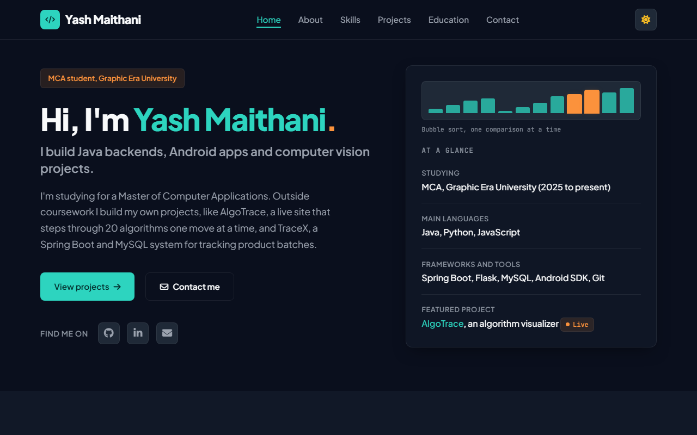

# Yash Maithani: Portfolio

My personal portfolio site. I'm an MCA student at Graphic Era University and I build projects in Java, Spring Boot, Android and Python.

Live site: [yash-maithani.github.io/MCA-Portfolio](https://yash-maithani.github.io/MCA-Portfolio/)



## What's on the site

- An introduction and the kind of role I'm looking for
- The languages, frameworks and tools I've used
- My projects, each linked to its source code
- My education
- A contact form and links to my email, GitHub and LinkedIn

The site has light and dark themes (the choice is saved in the browser), works on phones and desktops, and supports keyboard navigation. Cards fade in as you scroll and a small bubble sort runs in the header card; both switch off when the visitor's system asks for reduced motion.

## Projects

| Project | What it is | Built with | Code |
| --- | --- | --- | --- |
| AlgoTrace | Steps through 20 sorting, searching and graph algorithms one move at a time, with the reason and the code line for each step. [Live demo](https://algotrace-zxiw.onrender.com) | Python, Flask, JavaScript, D3.js | [AlgoTrace](https://github.com/Yash-Maithani/AlgoTrace) |
| Face and Emotion Recognition | Finds faces in images and video and classifies the emotion on each one | Python, computer vision | [Face-Insight](https://github.com/Yash-Maithani/Face-Insight) |
| TraceX | Tracks product batches and links them to their digital records | Java, Spring Boot, MySQL, REST | [TraceX](https://github.com/Yash-Maithani/TraceX-Smart-Product-Traceability-and-Inventory-Management-System-) |
| Android App | A Java and XML app for learning Android UI and event handling | Java, Android SDK | Not public |
| This portfolio | The site in this repository | HTML, CSS, JavaScript | You're here |

## How it's built

Plain HTML, CSS and JavaScript with no frameworks and no build step. Icons come from Font Awesome and the fonts are Plus Jakarta Sans and JetBrains Mono from Google Fonts. GitHub Pages serves the site from the root of the `main` branch and redeploys it on every push.

```text
MCA-Portfolio/
├── index.html      page content
├── style.css       styles and the light/dark theme colours
├── script.js       theme toggle, mobile menu, nav highlighting, contact form, animations
├── favicon.svg     site icon
└── assets/
    ├── algotrace.jpg   AlgoTrace screenshot for the featured project
    └── preview.png     screenshot used in this README
```

## Running it locally

Open `index.html` in a browser, or serve the folder so it behaves like the live site:

```bash
git clone https://github.com/Yash-Maithani/MCA-Portfolio.git
cd MCA-Portfolio
python -m http.server 8000
```

Then go to <http://localhost:8000>.

## Contact form

Without any setup, the form opens the visitor's email app with their message filled in. To have messages delivered directly instead, create a free form on [Formspree](https://formspree.io) and put its URL (for example `https://formspree.io/f/abcdwxyz`) in the `data-endpoint` attribute of the form in `index.html`.

## Contact

- Email: [yashmaithani425@gmail.com](mailto:yashmaithani425@gmail.com)
- LinkedIn: [yash-maithani-64b970260](https://www.linkedin.com/in/yash-maithani-64b970260)
- GitHub: [Yash-Maithani](https://github.com/Yash-Maithani)

## License

MIT
